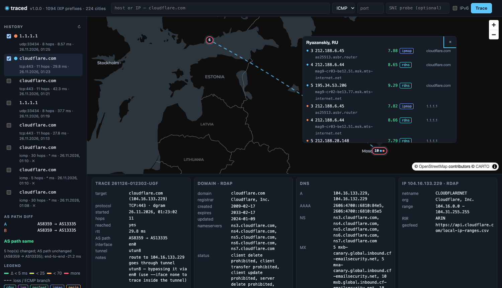

# traced

**traced** is a traceroute for people who need to know *where* packets actually go and *who* touches them.
It is a single static Go binary with a live MTR view, trace history with diffs and a local web map.

- **Probes:** ICMP, TCP and UDP over IPv4 and IPv6. ICMP works **without sudo** on macOS through an unprivileged datagram ICMP socket. When run as root, traced uses raw sockets.
- **ECMP:** every TTL gets several probes (3 by default), each on its own flow. Every router that answers is shown, so load-balanced branches are visible.
- **MPLS:** label stacks are decoded from ICMP extensions (RFC 4884 / RFC 4950).
- **SNI/DPI probe:** sends a TLS ClientHello with a chosen SNI and runs a TTL scan to find the hop where a RST, a silent drop or a ServerHello happens. A control SNI is sent for comparison.
- **Geolocation from several sources, checked against RTT physics:**
  - rDNS parsing: 220+ IATA/city codes plus backbone naming schemes (Cogent, Arelion, NTT CLLI, Lumen/Level3, GTT, HE, RETN, Rostelecom, MTS, Selectel, clouds…)
  - an IXP prefix table (1,094 PeeringDB prefixes are built in, and `traced update-ixp` refreshes them)
  - RFC 8805 geofeeds, found automatically through RDAP/WHOIS (RFC 9632)
  - RIPE IPmap
  - ip-api / ipinfo or a local `.mmdb`

  A location that would need faster-than-fibre RTT (for example "Ashburn" for a hop 5 ms from Moscow) is flagged `rtt_anomaly`. traced then falls back to the next plausible source, or interpolates from the neighbouring hops.
- **WHOIS/RDAP:** for a domain target: registrar, dates, NS, status, DNSSEC and DNS records. For an IP: ASN, org, netname, RIR and geofeed.
- **Live MTR:** an ANSI terminal UI with loss, jitter, sparklines, ASN, city/IXP and geo source.
- **History and diff:** every trace is stored, and `traced diff` shows changed hops, the AS path and RTT deltas.
- **Local web map** (`go:embed`, MapLibre GL, CARTO Dark Matter basemap):
  - city clusters you can click, arcs colored by RTT delta, and dashed lines for loss and ECMP branches
  - overlay of several routes, with an AS-path diff
  - live traces streamed over SSE



> **Privacy:** there are no remote probes. Everything runs on your machine. Trace data is never uploaded anywhere. Only lookups (RDAP, IPmap, GeoIP, DNS) and basemap tiles leave the host. `--offline` keeps geolocation local (rDNS, IXP table, local geofeeds, mmdb).
> The planned public home of the project is `traced.nuv.cx`. It is not live yet.


## Без установки (как bench.sh)

```sh
curl -fsSL https://raw.githubusercontent.com/PalMeany/traced-cli/main/run.sh | sh -s -- 1.1.1.1
wget -qO- https://raw.githubusercontent.com/PalMeany/traced-cli/main/run.sh | sh -s -- sni example.com
```

Скрипт определяет ОС/архитектуру (linux amd64/arm64/arm/386, macOS, FreeBSD), качает бинарник из последнего релиза во временную папку, сверяет SHA256, запускает с вашими аргументами и удаляет. На linux без root трассировка запускается через sudo. Конкретная версия: `TRACED_VERSION=v1.0.1`.

## Install

```sh
go install github.com/PalMeany/traced-cli/cmd/traced@latest
# or
git clone https://github.com/PalMeany/traced-cli && cd traced-cli && make install   # -> $(go env GOPATH)/bin/traced
```

Go 1.26+ is required. There are no CGO dependencies.

## Usage

```text
traced <target> [flags]          trace (ICMP by default)
traced mtr <target> [flags]      live MTR view (q quit, p pause, r reset, n names, m map)
traced sni <host> [--sni name]   TLS ClientHello probe: where does a filter cut the SNI
traced whois <domain|ip>         RDAP/WHOIS + DNS + ASN + geofeed
traced history [--limit N]       stored traces
traced diff <id1> <id2>          compare two traces (ids, unique prefixes or 1 = newest)
traced map [id...]               open the local web map (with traces preselected)
traced serve [--listen addr]     web UI without opening a browser (127.0.0.1:7477)
traced update-ixp                refresh the IXP prefix table from PeeringDB
```

Common flags:

| flag | meaning |
|---|---|
| `-I` / `-T` / `-U` | ICMP (default) / TCP SYN / UDP probes |
| `-p PORT` | destination port (TCP 443, UDP 33434) |
| `-4` / `-6` | force the address family |
| `-q N` | probes per hop (default 3, ECMP discovery) |
| `-m N`, `-w DUR`, `--gap DUR` | max TTL, probe timeout, pause between packets |
| `--paris` | keep one flow id (one path through load balancers) |
| `--iface auto\|none\|en0` | bind probes to an interface; `auto` (default) bypasses VPN/TUN routes |
| `--sni NAME` | run the SNI probe against the target after the trace |
| `--web` | open the result on the map |
| `--json` | machine-readable output |
| `--no-geo`, `--offline`, `--mmdb FILE`, `--geofeed FILE\|DIR` | geolocation controls |
| `--origin LAT,LON\|CODE` | your own location, for stricter RTT physics checks |
| `-n`, `--no-whois`, `--no-save` | numeric output; skip WHOIS; do not save the trace |

Environment variables: `TRACED_IPINFO_TOKEN`, `TRACED_MMDB`, `TRACED_IFACE`, `TRACED_ORIGIN`, `NO_COLOR`.
History is stored in `~/.local/share/traced/traces/*.json`. The cache (RDAP, PTR, ASN, IPmap, GeoIP, geofeeds, PeeringDB) lives in `~/.cache/traced/`.
Your own geofeeds can be dropped into `~/.config/traced/geofeeds/*.csv`.

## Examples

```console
$ traced cloudflare.com -T
› route to 104.16.133.229 goes through tunnel utun8 — bypassing it via en0 (use --iface none to trace inside the tunnel)
traced cloudflare.com (104.16.133.229) TCP:443 · dgram socket, via en0
  #  host                                         network                  location               source   rtt ms
  1  192.168.1.1                                                           private                         6.58 6.32 7.10
  3  as25513.asbr.router (212.188.6.45)           AS8359 MTS MTS PJSC      Ryazanskiy, RU         ipmap    10.9 7.73 9.23
  4  mag9-cr03-be12.51.msk.mts-internet.net (…)   AS8359 MTS MTS PJSC      Moscow, RU             rdns     9.88 8.25 9.97
  8  radio-cr01-ae3.0.hel.mts-internet.net (…)    AS8359 MTS MTS PJSC      Helsinki, FI           rdns     33.8 27.5 ECMP×2
  └  radio-cr01-ae9.0.hel.mts-internet.net (…)    AS8359 MTS MTS PJSC      Helsinki, FI           rdns     27.0
  9  162.158.236.6                                AS13335 CLOUDFLARENET    Helsinki, FI           geofeed  32.0 29.1 27.6
 11  104.16.133.229                               AS13335 CLOUDFLARENET    Helsinki, FI           interp   29.2 27.2 26.9 ⚠ rtt

RTT physics
  ⚠ 104.16.133.229   ipmap says Taipei TW, but 7349 km from Ryazanskiy (seen at 7.7 ms) — 7.7 + 26.9 ms RTT allow at most 3462 km → using interp

reached cloudflare.com in 11 hops, 27.8 ms, TCP probes · AS path AS8359 → AS13335 · saved 261126-011334-wyd

Domain cloudflare.com [rdap rdap.org]
  registrar    Cloudflare, Inc.
  created      2009-02-17
  expires      2033-02-17 (in 2275 days)
  …
IP 104.16.133.229 [rdap]
  ASN          AS13335 CLOUDFLARENET - Cloudflare, Inc., US
  geofeed      https://api.cloudflare.com/local-ip-ranges.csv
```

UDP shows MPLS label stacks and ECMP branches:

```console
$ traced 104.16.132.229 -U -n
  6  212.188.28.102      8.79 8.48 8.93 MPLS 63130
  8  212.188.29.109      33.4 34.2 ECMP×2
  └  212.188.29.23       43.5
```

The SNI probe locates the hop where interference starts:

```console
$ traced sni 104.16.133.229 --sni www.example-blocked.com
  ttl  9  ttl-exceeded   162.158.236.6      34.2 ms
  ttl 10  ttl-exceeded   162.158.236.11     36.3 ms
  ttl 11  rst            —                  28.0 ms    connection reset
SNI www.example-blocked.com → 104.16.133.229:443
  target   www.example-blocked.com  rst            30.3 ms
  control  example.com              server-hello   32.1 ms    TLS 1.3 h2
  path     server is 11 hops away, interference at TTL 11
  verdict  SERVER-REJECTED — … the server (or a box in front of it) refuses this name, no on-path DPI seen
```

A RST or silence that starts before the server's hop is reported as `SNI-BLOCKED … interference starts at TTL k (right after <router>)`.

Other commands:

```sh
traced mtr 1.1.1.1 -T -p 443     # live view
traced history                    # list
traced diff 2 1                   # previous vs newest
traced map 1 2                    # overlay both on the map
traced whois 8.8.8.8 --json
```

## How it works

- **Engine** (`internal/trace`):
  - Probes are sent in rounds. Round *i* sends flow *i* to every TTL, so no router gets a burst, and later rounds stop at the destination.
  - ICMP flows use a different echo id per flow, and the checksum is kept constant inside a flow (the Paris-traceroute trick). NATs keep one mapping per id, so flows that share an id lose their replies.
  - TCP probes are non-blocking `connect()` calls with `IP_TTL` set. UDP flows are bound sockets, and the payload length encodes the TTL.
  - Time-exceeded and unreachable messages are matched through the quoted inner header (TCP/UDP source port, UDP length, ICMP sequence).
- **Geo** (`internal/geo`):
  - Each source produces candidates with a confidence score.
  - The validator walks the path. A candidate is rejected when `dist(anchor, candidate) > (rtt_anchor + rtt_hop) × 100 km/ms + slack`. That is the triangle inequality with light in fibre at about 200 km/ms.
  - An optional `--origin` adds `dist(origin, candidate) ≤ rtt × 100 km`.
- **Web** (`internal/web`):
  - The server listens on 127.0.0.1.
  - Host and Origin are checked, which blocks DNS rebinding and cross-site requests to `/api/run`.
  - Traces stream over Server-Sent Events.

## Platform notes

- **macOS:** everything works without root. Under a VPN or TUN (sing-box, Clash, WireGuard), `--iface auto` binds the probes to the physical interface (`IP_BOUND_IF`). Without that, the tunnel would fake or hide the hops.
- **Linux:** unprivileged ping sockets do not receive the ICMP errors traceroute needs. Run traced as root, or give the binary the capability: `sudo setcap cap_net_raw+ep $(which traced)`. It will then use raw sockets, and that mode also decodes MPLS labels.
- **Rate limits:** the free ip-api endpoint allows 45 requests per minute. Results are cached for 7 days, so repeated traces are instant.

## Development

```sh
make test    # unit tests: packet/MPLS parser, rDNS/IATA, IXP, RFC 8805, RTT physics, ECMP/diff, RDAP/WHOIS, MTR stats, web guard
make build
make cross   # linux/darwin × amd64/arm64 into dist/
```
